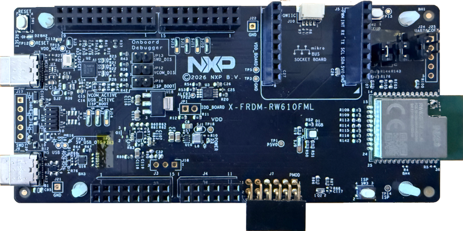

:pdf-download: ../../../_assets/boards/frdmrw610fml/mcuxsdk-frdmrw610fml.pdf

.. _frdmrw610fml:

FRDM-RW610FML
####################

Overview
********

FRDM-RW610FML is a compact and scalable development board designed for rapid prototyping with the RW610 series of Wi-Fi 6 and Bluetooth Low Energy dual-radio wireless MCUs. The board provides easy access to MCU I/Os and peripherals and includes open-standard serial interfaces, external flash memory, and an on-board MCU-Link debugger.
The RW610FML is a low-power, high-performance, certified Wi-Fi and Bluetooth combo module that supports IEEE 802.11a/b/g/n/ac/ax and Bluetooth Low Energy (Bluetooth LE) 5.4. It provides a comprehensive set of peripheral interfaces, including GPIO, SDIO, UART, SPI, PCM, I²C, I²S, PWM, ADC, DAC, USB, JTAG, SWD, LCD, DMIC, ACOMP, UTICK, USIM, WCI-2, and PTA through pin multiplexing. These interfaces provide design flexibility for a wide range of consumer applications.

MCU device and part on board is shown below:

 - Device: RW610
 - PartNumber: RW610FMLA2AI

SDK Introduction
*******************

.. only:: html

   For an introduction to the MCUXpresso SDK, see :doc:`MCUXpresso Software Development Kit (SDK) </introduction/README>`.

.. only:: latex

   .. toctree::
      :maxdepth: 1

      /introduction/README

Getting Started with Repository-Layout SDK Package
*******************************************
.. toctree::
   :maxdepth: 1

   gettingStarted/gsindex_repozip.md

Getting Started with MCUXpresso SDK GitHub
*******************************************
.. toctree::
   :maxdepth: 1

   ../../../gsd/repo.rst

Release Notes
*******************************************
.. toctree::
   :maxdepth: 1

   releaseNotes/rnindex.md

ChangeLog
*******************************************
.. toctree::
   :maxdepth: 1

   changeLog/clindex.md

Driver API Reference Manual
****************************

This section provides a link to the Driver API RM, detailing available drivers and their usage to help you integrate hardware efficiently.

:ref:`RW610_drivers`

Middleware Documentation
*****************************

Find links to detailed middleware documentation for key components. While not all onboard middleware is covered, this serves as a useful reference for configuration and development.

Wireless Connectivity Framework
===============================

:doc:`framework <../../../middleware/wireless/framework/index>`

MCU Boot
========

:doc:`mcuboot_opensource<../../../middleware/mcuboot_opensource/README>`

FreeMASTER
==========

:doc:`freemaster <../../../middleware/freemaster/doc/index>`

NXP Wi-Fi
=========

:ref:`wifi-bluetooth-802.15.4`

FreeRTOS
========

:ref:`freertos`

lwIP
====

:ref:`lwip`

File systemFatfs
================

:ref:`fatfs`

Trusted-Frimware-M
==================

:ref:`tfm`

LVGL
==================

:ref:`lvgl`

LittleFS
==================

:ref:`littlefs`

Mbed TLS 3.0
==================

:ref:`mbedtls3x`
